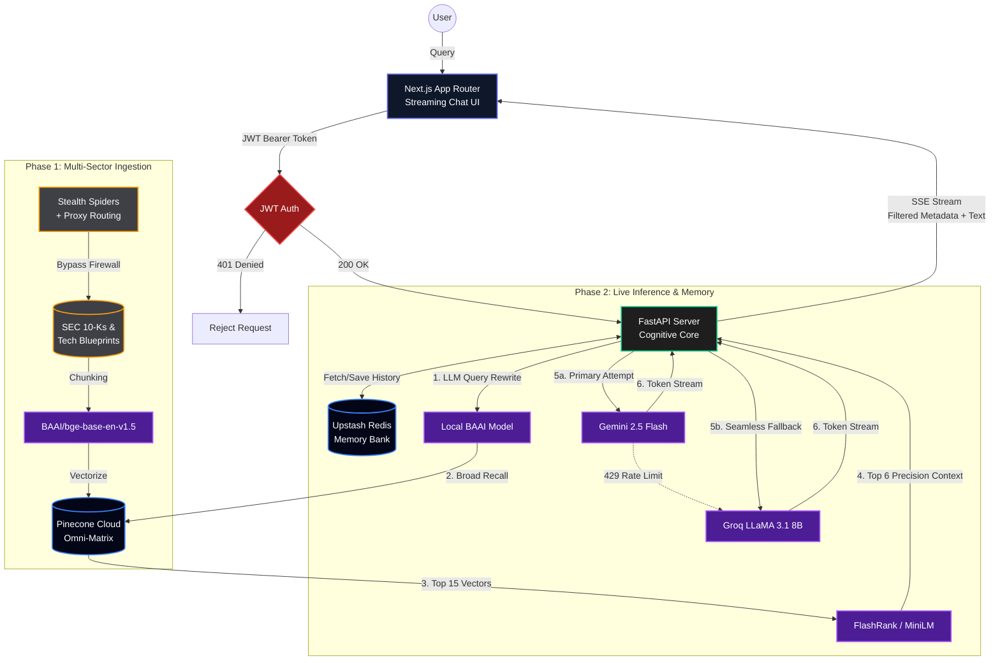

# Cognitive-Engine-V1
A high-performance cognitive search engine utilizing autonomous multi-agent ingestion, hybrid vector embeddings, and a Retrieval-Augmented Generation (RAG) pipeline.
<div align="center">
  
  
  # 🧠 The Founder's Oracle
  **Enterprise-Grade Cognitive Search & Dual-Core RAG Engine**

  [](#)
  [](#)
  [](#)
  [](#)
  [](#)
  [](#)
  [](#)
  
  *An invincible, multi-tenant architecture fusing SEC financial intelligence, deep-tech engineering roadmaps, and elite startup philosophy.*
</div>

---

## 🚀 Overview

The Founder's Oracle is a full-stack, streaming Retrieval-Augmented Generation (RAG) application. Moving beyond "naive" RAG, this engine employs a **Two-Stage Precision Retrieval System** (Bi-Encoder broad recall + Cross-Encoder precision reranking) to eliminate hallucinations and deliver hyper-accurate, context-aware syntheses in real-time.

### ⚡ Peak Architectural Capabilities
* **Dual-Core AI Waterfall (Self-Healing):** Implements a highly resilient failover system. If the Primary Core (Gemini 2.5) hits rate limits, the system instantly cascades to the Secondary Core (Groq LLaMA 3.1) with zero perceived downtime.
* **Cryptographic JWT Security:** The entire FastAPI backend is locked behind a mathematical JSON Web Token gatekeeper, securing the API against unauthorized access.
* **Cognitive Memory Bank:** Integrates Upstash Serverless Redis to store conversational history, utilizing an LLM pre-processor to rewrite pronouns and maintain contextual multi-turn memory.
* **The "Stealth Spider" Ingestion Swarm:** Custom Python scrapers equipped with Proxy Routing and Rate-Limit Armor to dynamically bypass government Akamai firewalls (SEC EDGAR) and extract raw financial data.
* **Omni-Matrix Knowledge Graph:** A highly diverse vector database combining Big Tech 10-K filings, Autonomous Robotics blueprints, and startup philosophy.
* **Zero-Latency UI with De-Duplication:** A dark-mode Next.js interface featuring interactive metadata citation chips, Server-Sent Events (SSE) streaming, and algorithmic visual de-duplication.

---

## 🏗️ System Architecture

The infrastructure is decoupled into an asynchronous data ingestion pipeline and a highly concurrent live serving environment.


--- 

## 🛠️ Tech Stack

| Domain | Technology | Purpose |
| :--- | :--- | :--- |
| **Frontend** | `Next.js 14`, `Tailwind CSS`, `Lucide` | Async client, Algorithmic De-Duplication, Markdown UI |
| **Backend API** | `FastAPI`, `Uvicorn`, `Python 3` | High-concurrency routing, SSE Streaming |
| **Primary AI Core**| `Google GenAI SDK`, `Gemini 2.5 Flash` | Ultra-fast token synthesis & memory rewriting |
| **Secondary AI Core**| `Groq`, `LLaMA-3.1-8B-Instant` | Zero-latency failover / fallback LLM engine |
| **Vector DB** | `Pinecone Serverless` | High-dimensional semantic storage (Cloud) |
| **Cognitive Memory**| `Upstash Redis Serverless` | High-speed conversational context storage |
| **Security** | `PyJWT`, `FastAPI HTTPBearer` | Enterprise-grade mathematical endpoint protection |
| **Ingestion Swarm** | `Requests`, `Proxy Routing`, `BS4` | Autonomous web crawling & firewall evasion |

## ⚙️ Local Development & Ignition

### 1. The Secure Vault
Create a `.env` file in the root directory and inject your cryptographic keys:
```env
# Vector & Embedding
PINECONE_API_KEY=your_pinecone_key_here
HF_TOKEN=your_huggingface_read_token_here

# Dual-Core AI Engines
GEMINI_API_KEY=your_gemini_key_here
GROQ_API_KEY=your_groq_key_here

# Cognitive Memory
UPSTASH_REDIS_REST_URL=your_upstash_url_here
UPSTASH_REDIS_REST_TOKEN=your_upstash_token_here

# Enterprise Security & Proxies
API_SECRET_KEY=your_custom_backend_secret
NEXT_PUBLIC_SECURE_JWT_TOKEN=your_generated_jwt_token
PROXY_URL=http://username:password@ip:port
```
### 2. Booting the Neural Core (Backend)
Open Terminal 1, activate your virtual environment, and ignite the FastAPI server:

```Bash
source venv/bin/activate
pip install -r requirements.txt
uvicorn api:app --reload --port 8000
Wait for the 🚀 Igniting Neural Cores... sequence to complete and bind to Port 8000.
```
### 3. Booting the UI (Frontend)
Open Terminal 2, navigate to the React directory, and start the development server:

```Bash
cd web-frontend
npm install
npm run dev
```
Navigate to *http://localhost:3000* (or your active Codespace port) to access the Oracle.

### 🗺️ Roadmap / Future Expeditions
* [x] **Vertical Slice:** Vector Matching & Generation
* [x] **Enterprise Architecture:** Streamlit -> Next.js Migration
* [x] **Peak Optimization:** Streaming SSE & Neural Reranking
* [x] **Data Expansion:** Stealth Spiders deployed for SEC filings & Omni-Matrix roadmaps
* [x] **Cognitive Memory:** Integrated Upstash Redis for multi-turn contextual awareness
* [x] **Resilience & Security:** Built JWT Gatekeeper & Dual-Core (Gemini/Groq) AI Waterfall
* [ ] **Cloud Deployment:** Containerize & deploy to Render (Backend) and Vercel (Frontend)

  **"Startups are so counterintuitive that if you trust your instincts, you'll make a lot of mistakes." — Paul Graham**

<div align="center">
<sub>Built with precision. Designed for scale.</sub>
</div>
